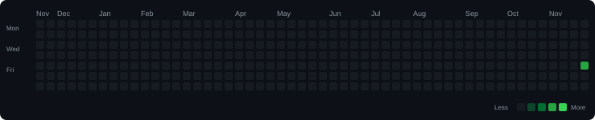

# ⚡ Coding Solutions Portfolio

> Automatically organized, analyzed, and updated by **CodeSyncVault**.

[](docs/AllProblems.md) [](docs/Basic.md) [](docs/Easy.md) [](docs/Medium.md) [](docs/Hard.md) [](https://github.com/vivekkushwahaofficial/CodeSyncVault)

---

## 📑 Table of Contents

- [📚 Solution Documentation](#-solution-documentation)
- [📈 Detailed Statistics](#-detailed-statistics)
- [⚙️ Workflow & Automation](#️-workflow--automation)
- [🗂 Repository](#-repository)

## 📊 Overview

| Metric | Count |
| --- | ---: |
| 🏆 Total Solved | 3 |
| 🔵 Basic | 1 |
| 🟢 Easy | 2 |
| 🟠 Medium | 0 |
| 🔴 Hard | 0 |

## 📈 Progress

| Difficulty | Progress | Solved |
| --- | --- | ---: |
| 🔵 Basic | ███████░░░░░░░░░░░░░ 33% | 1/3 |
| 🟢 Easy | █████████████░░░░░░░ 67% | 2/3 |
| 🟠 Medium | ░░░░░░░░░░░░░░░░░░░░ 0% | 0/3 |
| 🔴 Hard | ░░░░░░░░░░░░░░░░░░░░ 0% | 0/3 |

## 🔥 Coding Activity



## 🧩 Pattern Index

_No pattern data yet._

## 📚 Topic Index

| Topic | Problems |
| --- | ---: |
| [Math](topics/Math.md) | 2 |
| [Array](topics/Array.md) | 1 |
| [Graph](topics/Graph.md) | 1 |
| [String](topics/String.md) | 1 |

## 💻 Languages

| Language | Problems |
| --- | ---: |
| Java | 3 |

## 🌐 Platforms

| Platform | Problems |
| --- | ---: |
| HackerRank | 2 |
| GeeksforGeeks | 1 |

## 🕒 Recently Solved

| Problem | Difficulty | Language | Platform | Date |
| --- | --- | --- | --- | --- |
| [Largest in Array](gfg/Java/Basic/Largest-in-Array/README.md) | Basic | Java | GeeksforGeeks | 2026-11-26 |
| [ Java Stdin and Stdout I](HackerRank/Java/Easy/Java-Stdin-and-Stdout-I/README.md) | Easy | Java | HackerRank | 2026-11-26 |
| [Java If-Else](HackerRank/Java/Easy/Java-If-Else/README.md) | Easy | Java | HackerRank | 2026-11-26 |

## 📚 Solution Documentation

| Resource | Description |
| --- | --- |
| 📚 [All Problems](docs/AllProblems.md) | Complete solution index |
| 🔵 [Basic](docs/Basic.md) | Basic difficulty solutions |
| 🟢 [Easy](docs/Easy.md) | Easy difficulty solutions |
| 🟠 [Medium](docs/Medium.md) | Medium difficulty solutions |
| 🔴 [Hard](docs/Hard.md) | Hard difficulty solutions |
| 🧩 [Patterns](patterns/) | Problems grouped by solving pattern |
| 📚 [Topics](topics/) | Problems grouped by topic |

## 📈 Detailed Statistics

Explore the complete repository analytics including:

- Difficulty distribution
- Platform distribution
- Language usage
- Pattern distribution
- Topic distribution

➡️ **[View Detailed Statistics](stats/progress.md)**

## ⚙️ Workflow & Automation

CodeSyncVault automatically keeps this repository organized:

```text
Accepted Solution
       ↓
Metadata Extraction
       ↓
Pattern & Topic Analysis
       ↓
Solution Packaging
       ↓
GitHub Sync
       ↓
Repository Index Update
       ↓
README & Documentation Regeneration
```

No manual statistics or documentation maintenance is required.

## 🗂 Repository

| Resource | Purpose |
| --- | --- |
| 📚 [.codevault/index.json](.codevault/index.json) | Repository source of truth |
| 🔥 [.codevault/activity.svg](.codevault/activity.svg) | Coding activity heatmap |
| 🧩 [patterns/](patterns/) | Pattern-based indexes |
| 📚 [topics/](topics/) | Topic-based indexes |
| 📖 [docs/](docs/) | Difficulty & problem documentation |
| 📈 [stats/](stats/) | Repository statistics |

---

### 🤖 Powered by CodeSyncVault

This README and the repository documentation are generated automatically from the CodeSyncVault repository index.
